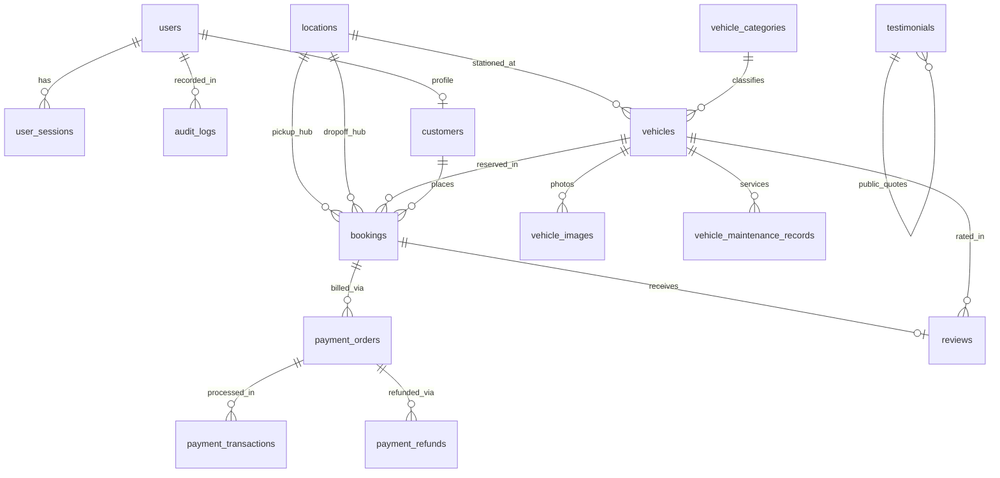

# Database Schema & Entity Relationships

This document details the relational database schema, data models, table columns, data types, indexes, and foreign key constraints for the AutoFleet Car Rental Platform.

---

## 1. Database Engine & Conventions

- **Database Engine**: PostgreSQL 16 Alpine
- **Required Extensions**:
  - `btree_gist`: Enables scalar equality (`=`) and timestamp range comparisons (`&&`) in PostgreSQL GiST indexes.
  - `pgcrypto` / `uuid-ossp`: Provides UUID generation functions (`gen_random_uuid()`).
- **Global Table Conventions**:
  - **Primary Keys**: Universally Unique Identifiers (`UUIDv4`) generated server-side or in application code via `UUIDPrimaryKeyMixin`.
  - **Timestamps**: All tables implement `created_at` and `updated_at` storing timezone-aware UTC timestamps (`DateTime(timezone=True)`).
  - **Soft Deletion**: Entities inherit `SoftDeleteMixin` providing `is_deleted` (indexed boolean) and `deleted_at`.
  - **Enums**: PostgreSQL native types for enumerated values (`user_role_enum`, `vehicle_category_enum`, `vehicle_status_enum`, `booking_status_enum`, `payment_status_enum`, etc.).

---

## 2. Entity Relationship Diagram (ERD)

---

## 3. Core Table Definitions

### 3.1 `users`
Stores system accounts, internal users, staff, and customer credentials.
- `id`: `UUID` (Primary Key)
- `email`: `VARCHAR(255)` (Unique, Indexed)
- `hashed_password`: `VARCHAR(255)` (Argon2id Hash)
- `full_name`: `VARCHAR(150)`
- `role`: `user_role_enum` (`CUSTOMER`, `STAFF`, `ADMIN`)
- `is_active`: `BOOLEAN` (Default: `true`, Indexed)
- `is_verified`: `BOOLEAN` (Default: `false`)
- `phone_number`: `VARCHAR(32)` (Nullable)
- `documents`: `JSONB` (Driver license details, state, expiry)
- `failed_login_attempts`: `INTEGER` (Default: `0`)
- `locked_until`: `TIMESTAMPTZ` (Nullable)
- `created_at`, `updated_at`, `is_deleted`, `deleted_at`

### 3.2 `user_sessions`
Tracks active user sessions, refresh token hashes, and enables revocation.
- `id`: `UUID` (Primary Key)
- `user_id`: `UUID` (Foreign Key -> `users.id`, ondelete `CASCADE`)
- `refresh_token_hash`: `VARCHAR(255)` (Unique, Indexed)
- `user_agent`: `VARCHAR(255)` (Nullable)
- `ip_address`: `VARCHAR(45)` (Nullable)
- `expires_at`: `TIMESTAMPTZ` (Indexed)
- `is_revoked`: `BOOLEAN` (Default: `false`, Indexed)
- `created_at`, `updated_at`

### 3.3 `locations`
Branch stations, operational dispatch hubs, and airport pickup centers.
- `id`: `UUID` (Primary Key)
- `code`: `VARCHAR(16)` (Unique, Indexed)
- `name`: `VARCHAR(100)`
- `address`: `VARCHAR(255)`
- `city`: `VARCHAR(100)`
- `state`: `VARCHAR(100)`
- `postal_code`: `VARCHAR(20)`
- `latitude`, `longitude`: `DOUBLE PRECISION`
- `phone`: `VARCHAR(32)`
- `is_active`: `BOOLEAN` (Default: `true`)
- `created_at`, `updated_at`, `is_deleted`, `deleted_at`

### 3.4 `vehicle_categories`
Classification definitions for fleet categorization.
- `id`: `UUID` (Primary Key)
- `name`: `VARCHAR(50)` (Unique)
- `slug`: `VARCHAR(50)` (Unique, Indexed)
- `description`: `TEXT`
- `sort_order`: `INTEGER` (Default: `0`)
- `is_active`: `BOOLEAN` (Default: `true`)
- `created_at`, `updated_at`

### 3.5 `vehicles`
Physical fleet inventory and configuration.
- `id`: `UUID` (Primary Key)
- `vin`: `VARCHAR(17)` (Unique, Indexed)
- `license_plate`: `VARCHAR(16)` (Unique, Indexed)
- `make`: `VARCHAR(50)`
- `model`: `VARCHAR(50)`
- `year`: `INTEGER`
- `color`: `VARCHAR(30)`
- `category_id`: `UUID` (Foreign Key -> `vehicle_categories.id`)
- `location_id`: `UUID` (Foreign Key -> `locations.id`)
- `seating_capacity`: `INTEGER`
- `transmission`: `VARCHAR(20)`
- `fuel_type`: `VARCHAR(20)`
- `mileage`: `INTEGER`
- `daily_rate`: `NUMERIC(10, 2)`
- `status`: `vehicle_status_enum` (`AVAILABLE`, `RENTED`, `MAINTENANCE`, `DISPATCHED`, `RETIRED`)
- `sort_order`: `INTEGER` (Default: `0`)
- `is_active`: `BOOLEAN` (Default: `true`, Indexed)
- `created_at`, `updated_at`, `is_deleted`, `deleted_at`

### 3.6 `bookings`
Customer trip reservations and dispatch records.
- `id`: `UUID` (Primary Key)
- `booking_reference`: `VARCHAR(32)` (Unique, Indexed)
- `customer_id`: `UUID` (Foreign Key -> `customers.id`)
- `vehicle_id`: `UUID` (Foreign Key -> `vehicles.id`)
- `pickup_location_id`: `UUID` (Foreign Key -> `locations.id`)
- `return_location_id`: `UUID` (Foreign Key -> `locations.id`)
- `start_datetime`: `TIMESTAMPTZ` (Indexed)
- `end_datetime`: `TIMESTAMPTZ` (Indexed)
- `rental_period`: `TSTZRANGE`
- `status`: `booking_status_enum` (`PENDING`, `CONFIRMED`, `ACTIVE`, `COMPLETED`, `CANCELLED`)
- `journey_type`: `VARCHAR(32)` (`outstation_oneway`, `outstation_roundtrip`, `local`, `airport`)
- `total_price`: `NUMERIC(10, 2)`
- `total_price_cents`: `INTEGER`
- `pickup_address`: `TEXT` (Nullable)
- `drop_address`: `TEXT` (Nullable)
- `created_at`, `updated_at`, `is_deleted`, `deleted_at`

### 3.7 `payment_orders`, `payment_transactions`, `payment_refunds`
Financial transactions and webhook audit tracking.
- `payment_orders`: Tracks the commercial invoice, gross amount, currency, and payment lifecycle.
- `payment_transactions`: Captures gateway transaction ID, card last 4 digits, UPI handle, and captured timestamp.
- `payment_refunds`: Captures partial or complete refunds issued against an order.

### 3.8 `testimonials`
Canonical customer reviews and ratings displayed on the public website.
- `id`: `UUID` (Primary Key)
- `name`: `VARCHAR(150)`
- `designation`: `VARCHAR(150)`
- `review`: `TEXT`
- `rating`: `INTEGER` (1-5)
- `image_url`: `VARCHAR(500)`
- `is_active`: `BOOLEAN` (Default: `true`)
- `sort_order`: `INTEGER` (Default: `0`)
- `created_at`, `updated_at`, `is_deleted`, `deleted_at`
